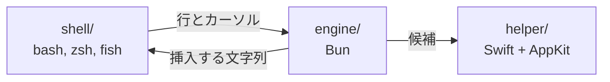

# Linux 移植の方針（Kubuntu / KDE Plasma Wayland）

このフォーク専用のメモ。本家（[en3sis/figxit](https://github.com/en3sis/figxit)）への PR には含めない。

## 目的と範囲

目的は、自分の Kubuntu 環境で Figxit を使えるようにすること。Linux はデスクトップ環境が多すぎるため、全部には対応しない。

動作を確認するのは次の環境だけ。

| 項目 | 対象 |
|---|---|
| OS | Kubuntu 26.04 LTS |
| デスクトップ | KDE Plasma 6.6（Wayland セッション） |
| ターミナル | Konsole |
| シェル | bash 5.3 |

- zsh、fish、tmux は、本家のスクリプトがそのまま動けば使う。動作確認はしない
- GNOME、X11 セッション、Sway や Hyprland は実装しない。ただし、あとから追加しやすい構造にしておく
- macOS での挙動は変えない

## 基本方針

1. **自分の環境で動くことを優先する。** 他の環境は「追加しやすい構造」までにとどめ、実装もテストもしない。
2. **環境に依存する部分を分けておく。** デスクトップ環境、Wayland プロトコル、ターミナルに依存するコードはそれぞれバックエンドとして切り出す。他の環境に対応するときは、バックエンドを 1 つ足すだけで済むようにする。
3. **本家への PR は 2 段階に分ける。**
   - engine と shell を OS に依存しない形にする変更は、本家に送る。小さく、mac 側の挙動を変えない変更にする
   - Linux 用 helper は当面フォーク側で持つ。本家が欲しがれば [#35](https://github.com/en3sis/figxit/issues/35) で相談する
4. **本家に追従し続ける。** 本家は engine と shell の修正が頻繁に入る。本家のファイルへの変更は最小限にして、upstream の取り込みで衝突しにくくする。

## 全体の構成

macOS 版は 3 つの部分がソケットでやりとりしている。



Linux でもこの構成は変えない。差し替えるのは helper だけ。

| 部分 | macOS | Linux |
|---|---|---|
| shell | `shell/` | そのまま（起動まわりのパスだけ直す） |
| engine | `engine/`（Bun） | そのまま（OS 依存の数か所だけ直す） |
| helper | `helper/`（Swift + AppKit） | `helper-linux/` を新しく作る |

engine と helper の間のプロトコルは macOS 版と同じものを使う。そうすれば engine は helper の実装を気にしなくてよい。

- ソケット：`~/.local/state/figxit/helper.sock`（`FIGXIT_HELPER_SOCK` で変更可）
- 形式：JSON を 1 行ずつ
- engine から helper へ：`show`、`select`、`hide`、`probe`、`open`、`quit`（`helper/Sources/figxit-helper/main.swift` を参照）
- helper から engine へ：`{"event":"hidden"}`
- 型の定義：`helper/Sources/figxit-helper/Protocol.swift`

## helper-linux の設計

### 使う技術

**C++20 + Qt 6 + LayerShellQt + CMake** を使う。

- Kubuntu には Qt 6 と LayerShellQt が最初から入っていて、KDE との相性もよい
- LayerShellQt には C++ の API しかない（Python から使えない）
- Swift は Linux でも動くが、AppKit がないので結局書き直しになる
- GTK 4 + gtk4-layer-shell や Rust でも作れる。KDE で動かすなら Qt が素直

### 層の分け方

| 層 | 役割 | 依存先 | 最初に作る実装 | 他の環境で足すもの |
|---|---|---|---|---|
| Server | `helper.sock` で engine と通信する | なし（共通） | — | — |
| Placement | grid、ウィンドウの矩形、ターミナルの余白からポップアップの座標を求める | なし（純粋関数） | macOS 版 `Geometry.swift` の計算を移植 | — |
| Popup | 候補リストを描く | Qt（共通） | — | — |
| WindowLocator | 前面のウィンドウの位置、pid、出力先の画面を取る | デスクトップ環境 | KWin スクリプト + D-Bus | GNOME：Shell 拡張、Sway：`swaymsg -t get_tree`、Hyprland：`hyprctl activewindow`、X11：EWMH |
| Surface | ポップアップを好きな座標に、フォーカスを奪わずに出す | Wayland プロトコル | layer-shell（LayerShellQt） | GNOME：別の方法が必要、X11：override-redirect ウィンドウ |
| TerminalProfile | ウィンドウの中でテキスト領域がどこにあるかを補正する | ターミナル | Konsole | ターミナルごとに追加 |

バックエンドは起動時に `XDG_CURRENT_DESKTOP` と `WAYLAND_DISPLAY` を見て選ぶ。環境変数（例：`FIGXIT_WINDOW_BACKEND`）で上書きできるようにする。

インターフェースはおおよそ次の形にする。

```cpp
struct WindowInfo {
    qint64 pid;
    QString appId;      // 例：org.kde.konsole
    QRect client;       // 装飾を除いたウィンドウの矩形（全体座標、論理ピクセル）
    QScreen *screen;
};

class WindowLocator : public QObject {
    Q_OBJECT
public:
    virtual std::optional<WindowInfo> active() const = 0;
signals:
    void changed();     // フォーカスや位置が変わったとき
};

class PopupSurface {
public:
    virtual void place(const QRect &global, QScreen *screen) = 0;
    virtual void show() = 0;
    virtual void hide() = 0;
};

struct TerminalProfile {
    // ウィンドウ内でのテキスト領域（ウィンドウ相対）
    virtual QRect textArea(const WindowInfo &window, const Grid &grid) const = 0;
};
```

### ディレクトリ構成（案）

```
helper-linux/
  CMakeLists.txt
  src/
    main.cpp
    server.{h,cpp}           # helper.sock、JSON の 1 行ずつの読み書き
    protocol.h               # Protocol.swift と同じ型
    placement.{h,cpp}        # 配置の計算（純粋関数）
    popup.{h,cpp}            # 描画
    surface/layershell.{h,cpp}
    locator/kwin.{h,cpp}
    locator/kwin/active-window.js   # KWin に読み込ませるスクリプト
    terminal/konsole.{h,cpp}
  tests/
    placement_test.cpp
```

## 技術的な課題と対応案

### 1. ターミナルのウィンドウの位置

Wayland では、アプリが他のウィンドウの位置を取れない。

- KWin スクリプトを D-Bus（`org.kde.KWin` の `/Scripting`）経由で読み込む
- スクリプトで `workspace.windowActivated` とウィンドウの `frameGeometryChanged` を購読し、`callDBus` で helper に通知する。ポーリングはしない
- 装飾を除いた `clientGeometry` を使う。タイトルバーの高さを決め打ちしなくて済む
- `pid` も取れるので、前面のウィンドウがシェルの親のターミナルかどうかを確かめられる

### 2. ポップアップを好きな座標に出す

Wayland では、普通のウィンドウは自分の位置を決められない。

- layer-shell の overlay 層に出す。上と左に anchor し、margin で位置を指定する
- margin は画面（出力）からの相対位置なので、全体座標から画面の位置を引く
- `KeyboardInteractivityNone` にしてフォーカスを奪わない。キー入力はシェル側で処理しているので、ポップアップはキーを受け取らなくてよい
- layer-shell は KWin、wlroots 系、Hyprland、niri、COSMIC で使えるが、GNOME では使えない

### 3. ウィンドウの中のテキスト領域

Konsole はメニューバー、タブバー、ツールバー、スクロールバーがウィンドウの中にある。macOS 版では Accessibility でテキスト領域を探している部分にあたる。

- 最初は「テキスト領域はウィンドウの左下に寄っている」と仮定し、行数 × セルの高さと余白から逆算する
- それでずれる場合は、AT-SPI で Konsole のテキスト領域の位置を取る。Wayland では画面上の座標は取れないが、ウィンドウからの相対位置なら取れる見込み（要検証）

### 4. セルの大きさ（ピクセル）

engine の `parseShell`（`engine/src/geometry.ts`）は、シェルがターミナルに問い合わせたセルの大きさ、またはテキスト領域の大きさを使う。Konsole がこの問い合わせに答えるかは要検証。答えない場合は、ウィンドウの大きさを桁数で割って推定する。

### 5. HiDPI と分数スケーリング

KWin の座標は論理ピクセルで、Qt も論理ピクセルで扱う。125% や 150% で位置がずれないかを確かめる。

### 6. helper の起動

engine は helper が動いていないとき `open -g`（macOS のコマンド）で起動している（`engine/src/helper.ts`）。Linux では helper の実行ファイルを直接起動する。あとで必要になれば systemd のユーザーサービスにする。

### 7. 後回しにするもの

- メニューバーのアイコン → トレイアイコン（StatusNotifierItem、`QSystemTrayIcon`）
- 設定画面、About、`figxit doctor` の Linux 用の表示
- 自動アップデート（Sparkle）は対応しない

## engine と shell の変更点（本家に送る候補）

いま見つかっている macOS 前提の箇所。

| 場所 | 内容 |
|---|---|
| `engine/src/helper.ts` | helper の起動に `open -g` を使っている |
| `engine/src/paths.ts` | `bundlePath`、`appPath`、`specsDir` が `.app/Contents/MacOS` の構成を前提にしている |
| `engine/src/geometry.ts` | Ghostty のパスが `/Applications/Ghostty.app/...` 決め打ち |
| `engine/src/main.ts` | `figxit doctor` が Accessibility を表示する。PATH の候補に `/opt/homebrew/bin` |
| `shell/*/figxit.*`、`shell/*/connect.*` | engine の場所が `$FIGXIT_APP/Contents/MacOS/figxit-engine` 決め打ち |
| `shell/zsh/connect.zsh` | helper の起動に `open -g` |
| `scripts/dev.sh`、`scripts/build.sh`、`Makefile` | `open -g`、`xcrun swift test`、`.app` の組み立て |

本家に送るときの決まり。

- macOS での挙動を変えない
- OS ごとの分岐は小さくまとめ、1 つの PR では 1 つのことだけ直す
- コミットメッセージは本家に合わせる（`feat:` / `fix:` と平易な英語）
- Linux 用 helper のコードは混ぜない

## 進め方

1. **準備**：upstream を remote に追加し、Bun を入れて、`engine` のテストが Linux で通るかを見る
2. **engine だけ動かす**：`helper.sock` に届いた JSON をログに出すだけの仮の helper を作り、bash + Konsole で候補が届くことを確かめる
3. **ポップアップを出す**：layer-shell で固定の位置にポップアップを出す。フォーカスを奪わないことを確かめる
4. **カーソルの下に出す**：KWin スクリプトでウィンドウの位置を取り、カーソルの下に出す（画面 1 枚、Konsole のメニューバーとタブバーは非表示）
5. **実用的にする**：Konsole のメニューバーやタブバーあり、複数の画面、スケーリング
6. **tmux**：engine にある tmux 用の位置計算がそのまま使えるかを確かめる
7. **仕上げ**：トレイアイコン、設定、`figxit doctor`
8. **本家に送る**：engine と shell の変更を、本家の `main` から切ったブランチで PR にする

## 本家との関係

- [#35](https://github.com/en3sis/figxit/issues/35) にコメントする。KDE Wayland で着手すること、engine と shell の変更を先に送ること、Linux 用 helper は当面フォーク側で持つことを伝える
- ブランチの使い方
  - `main`：本家の `main` に Linux 対応を足したもの
  - 本家に送る変更：`upstream/main` から切ったブランチで作る（Linux 用 helper を混ぜないため）
- GitHub 上でこのリポジトリが本家のフォークになっているかを確かめる。なっていないと本家に PR を出せない

## 未検証・要確認

- Konsole がセルの大きさの問い合わせに答えるか
- AT-SPI で Konsole のテキスト領域の位置がウィンドウ相対で取れるか
- KWin スクリプトから D-Bus で届く通知が、キー入力ごとの表示に間に合うか
- layer-shell の margin を変えてポップアップを動かすときにちらつかないか
- Linux 版の Bun で `engine` のテストが通るか
- LayerShellQt の開発用パッケージ名（候補：`liblayershellqtinterface-dev`）
