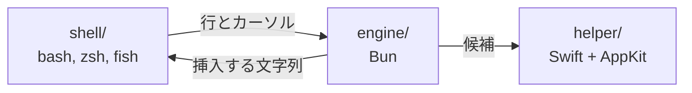

# Linux 移植の方針（Kubuntu / KDE Plasma Wayland）

このフォーク専用のメモ。本家（[en3sis/figxit](https://github.com/en3sis/figxit)）への PR には含めない。

## 目的と範囲

目的は、自分の Kubuntu 環境で Figxit を使えるようにすること。Linux はデスクトップ環境が多すぎるため、全部には対応しない。

動作を確認するのは次の環境だけ。

| 項目 | 対象 |
|---|---|
| OS | Kubuntu 26.04 LTS |
| デスクトップ | KDE Plasma 6.6（Wayland セッション） |
| ターミナル | Konsole |
| シェル | bash 5.3 |

- zsh、fish、tmux は、本家のスクリプトがそのまま動けば使う。動作確認はしない
- GNOME、X11 セッション、Sway や Hyprland は実装しない。ただし、あとから追加しやすい構造にしておく
- macOS での挙動は変えない

## 基本方針

1. **自分の環境で動くことを優先する。** 他の環境は「追加しやすい構造」までにとどめ、実装もテストもしない。
2. **環境に依存する部分を分けておく。** デスクトップ環境、Wayland プロトコル、ターミナルに依存するコードはそれぞれバックエンドとして切り出す。他の環境に対応するときは、バックエンドを 1 つ足すだけで済むようにする。
3. **本家への PR は 2 段階に分ける。**
   - engine と shell を OS に依存しない形にする変更は、本家に送る。小さく、mac 側の挙動を変えない変更にする
   - Linux 用 helper は当面フォーク側で持つ。本家に入れたいかは、engine と shell の PR がマージされてから [#35](https://github.com/en3sis/figxit/issues/35) で聞く（下の「本家との関係」）
4. **本家に追従し続ける。** 本家は engine と shell の修正が頻繁に入る。本家のファイルへの変更は最小限にして、upstream の取り込みで衝突しにくくする。

## 全体の構成

macOS 版は 3 つの部分がソケットでやりとりしている。



Linux でもこの構成は変えない。差し替えるのは helper だけ。

| 部分 | macOS | Linux |
|---|---|---|
| shell | `shell/` | そのまま（起動まわりのパスだけ直す） |
| engine | `engine/`（Bun） | そのまま（OS 依存の数か所だけ直す） |
| helper | `helper/`（Swift + AppKit） | `helper-linux/` を新しく作る |

engine と helper の間のプロトコルは macOS 版と同じものを使う。そうすれば engine は helper の実装を気にしなくてよい。

- ソケット：`~/.local/state/figxit/helper.sock`（`FIGXIT_HELPER_SOCK` で変更可）
- 形式：JSON を 1 行ずつ
- engine から helper へ：`show`、`select`、`hide`、`probe`、`open`、`quit`（`helper/Sources/figxit-helper/main.swift` を参照）
- helper から engine へ：`{"event":"hidden"}`
- 型の定義：`helper/Sources/figxit-helper/Protocol.swift`

## helper-linux の設計

### 使う技術

**C++20 + Qt 6 + LayerShellQt + CMake** を使う。

- Kubuntu には Qt 6 と LayerShellQt が最初から入っていて、KDE との相性もよい
- LayerShellQt には C++ の API しかない（Python から使えない）
- Swift は Linux でも動くが、AppKit がないので結局書き直しになる
- GTK 4 + gtk4-layer-shell や Rust でも作れる。KDE で動かすなら Qt が素直

### 層の分け方

| 層 | 役割 | 依存先 | 最初に作る実装 | 他の環境で足すもの |
|---|---|---|---|---|
| Server | `helper.sock` で engine と通信する | なし（共通） | — | — |
| Placement | grid、ウィンドウの矩形、ターミナルの余白からポップアップの座標を求める | なし（純粋関数） | macOS 版 `Geometry.swift` の計算を移植 | — |
| Popup | 候補リストを描く | Qt（共通） | — | — |
| WindowLocator | 前面のウィンドウの位置、pid、出力先の画面を取る | デスクトップ環境 | KWin スクリプト + D-Bus | GNOME：Shell 拡張、Sway：`swaymsg -t get_tree`、Hyprland：`hyprctl activewindow`、X11：EWMH |
| Surface | ポップアップを好きな座標に、フォーカスを奪わずに出す | Wayland プロトコル | layer-shell（LayerShellQt） | GNOME：別の方法が必要、X11：override-redirect ウィンドウ |
| TerminalProfile | ターミナルごとの癖を補正する（セルの大きさの単位など） | ターミナル | Ghostty（macOS 版から移植） | ターミナルごとに表に 1 行 |
| FocusTracker | フォーカスのある要素と、そのまわりのテキスト領域を取る | アクセシビリティ | AT-SPI（D-Bus） | Linux ならデスクトップ環境を問わず同じ |

バックエンドは起動時に `backends.cpp` で選ぶ。`main.cpp` がそれを `Helper` に渡し、`Helper` は `WindowLocator`、`PopupSurface`、`FocusTracker` のインターフェースだけを知っている。KWin、layer-shell、AT-SPI を直接は使わない。テスト（`tests/helper_test.cpp`）は偽物を渡して、一覧の出し方と閉じ方を確かめる。

- WindowLocator：`backends.cpp` の表に並べた順に、使えるもの（KWin なら D-Bus に `org.kde.KWin` がある）を試し、最初に `start()` できたものを使う。`FIGXIT_WINDOW_BACKEND=kwin` のように名前で選べる。`none` にすると使わない（ポップアップは固定の位置に出る）
- PopupSurface：Qt のプラットフォームが Wayland で、LayerShellQt を入れてビルドしたときは layer-shell。どれも使えなければ、helper は動くが `show` に失敗を返す
- 他の環境に対応するときは、`locator/` か `surface/` にファイルを 1 つ足し、`backends.cpp` に 1 行足す。LayerShellQt はビルドに必須ではない（CMake は見つかったときだけ `surface/layershell.cpp` を加える）

インターフェースはおおよそ次の形にする。

```cpp
struct WindowInfo {
    qint64 pid;
    QString appId;      // 例：org.kde.konsole
    QRect client;       // 装飾を除いたウィンドウの矩形（全体座標、論理ピクセル）
    QScreen *screen;
};

class WindowLocator : public QObject {
    Q_OBJECT
public:
    virtual bool start() = 0;
    virtual std::optional<WindowInfo> active() const = 0;
signals:
    void changed();     // フォーカスや位置が変わったとき
};

class PopupSurface {
public:
    virtual void place(const QRect &global, QScreen *screen) = 0;
    virtual void show() = 0;
    virtual void hide() = 0;
};

struct TerminalProfile {
    bool devicePixels = false;  // セルの大きさを実ピクセルで答える
};
TerminalProfile terminalProfile(const QString &appId);
```

### ディレクトリ構成

```
helper-linux/
  CMakeLists.txt
  dev.sh                     # make dev の Linux 版。helper と engine を起動する
  src/
    main.cpp                 # 起動。引数、ロック、シグナル、helper.sock、engine の起動
    helper.{h,cpp}           # engine の命令の処理と、一覧を出す・閉じる判断（Helper クラス）
    server.{h,cpp}           # helper.sock、JSON の 1 行ずつの読み書き
    protocol.{h,cpp}         # Protocol.swift と同じ型
    popup.{h,cpp}            # 描画
    theme.{h,cpp}            # 色。kdeglobals から読む
    placement.{h,cpp}        # 配置の計算（Geometry.fit と visibleSurface の移植、純粋関数）
    terminals.{h,cpp}        # ターミナルごとの補正（TerminalProfile）。app id で引く
    focus.h                  # FocusTracker
    accessibility.{h,cpp}    # AT-SPI でフォーカスのある要素からテキスト領域を探す（VS Code）
    backends.{h,cpp}         # デスクトップごとの WindowLocator、PopupSurface、FocusTracker を選ぶ
    surface.h                # PopupSurface
    surface/layershell.{h,cpp}
    locator.h                # WindowLocator
    locator/kwin.{h,cpp}
    locator/kwin-locator.js  # KWin に読み込ませるスクリプト
    resources.qrc
  tests/
    placement_test.cpp       # GeometryTests.swift の移植と Linux 用のテスト
    helper_test.cpp          # Helper に偽の locator、surface、FocusTracker を渡すテスト
```

ターミナルごとの補正（TerminalProfile）は、Konsole では要らなかった（下の 3）。`terminals.{h,cpp}` の表に app id ごとに書く。いまは Ghostty（`com.mitchellh.ghostty`）の「セルの大きさを実ピクセルで答える」だけで、これは macOS 版の `Geometry.physicalPixels` の移植（Linux の Ghostty では未確認）。必要なターミナルが出てきたら、この表に 1 行足す。

## 技術的な課題と対応案

### 1. ターミナルのウィンドウの位置

Wayland では、アプリが他のウィンドウの位置を取れない。

- KWin スクリプトを D-Bus（`org.kde.KWin` の `/Scripting`）経由で読み込む
- スクリプトで `workspace.windowActivated` とウィンドウの `frameGeometryChanged` を購読し、`callDBus` で helper に通知する。ポーリングはしない
- 装飾を除いた `clientGeometry` を使う。タイトルバーの高さを決め打ちしなくて済む
- `pid` も取れるので、前面のウィンドウがシェルの親のターミナルかどうかを確かめられる

実装（`locator/kwin.cpp`）：

- helper は D-Bus に `/Locator`（`org.figxit.Locator`）を出し、スクリプトは helper の一意な D-Bus 名（`:1.234` の形）に `callDBus` する。決まった名前を取らなくて済む
- スクリプトは `$XDG_RUNTIME_DIR/figxit-locator.js` に書き出して読み込ませる。共有の一時フォルダには書かない（ほかのユーザーが同じ名前のファイルを先に置くと、それを KWin に読み込ませることになる）。`XDG_RUNTIME_DIR` がないときは Qt が自分専用のフォルダを作り、それも使えなければ KWin を使わない。名前は `figxit-locator` に固定し、起動時に古いものを外してから読み込む
- helper の終了時（SIGTERM、SIGINT、SIGHUP を含む）にスクリプトを外す
- 送るのは JSON の文字列 1 つ。JavaScript の数値が D-Bus の int か double のどちらになるかを気にしなくて済む
- 別のウィンドウがアクティブになったら、ポップアップを閉じて engine に `{"event":"hidden"}` を送る。同じウィンドウが動いたり大きさが変わったりしたら、置き直す
- KWin がアクティブなウィンドウを知らせていない（デスクトップをクリックした後など）ときの `show` は、`no terminal window` で失敗にする（macOS 版と同じ）。固定の位置に出すのは、locator がないときだけ
- `figxit-helper --locate` で、KWin が知らせてくる内容を見られる

### 2. ポップアップを好きな座標に出す

Wayland では、普通のウィンドウは自分の位置を決められない。

- layer-shell の overlay 層に出す。上と左に anchor し、margin で位置を指定する
- margin は画面（出力）からの相対位置なので、全体座標から画面の位置を引く
- `KeyboardInteractivityNone` にしてフォーカスを奪わない。キー入力はシェル側で処理しているので、ポップアップはキーを受け取らなくてよい
- layer-shell は KWin、wlroots 系、Hyprland、niri、COSMIC で使えるが、GNOME では使えない

### 3. ウィンドウの中のテキスト領域

Konsole はメニューバー、タブバー、ツールバー、スクロールバーがウィンドウの中にある。macOS 版では Accessibility でテキスト領域を探している部分にあたる。

- 最初は「テキスト領域はウィンドウの左下に寄っている」と仮定し、行数 × セルの高さと余白から逆算する
- それでずれる場合は、AT-SPI で Konsole のテキスト領域の位置を取る。Wayland では画面上の座標は取れないが、ウィンドウからの相対位置なら取れる見込み（要検証）

結果：macOS 版で Accessibility がないときの計算（`Geometry.fit` の `cg`）がそのまま使えた。テキスト領域の上端を「ウィンドウの下端 − 行数 × セルの高さ」とするもので、Konsole のメニューバーとタブバーを表示したままでも位置は合う。Konsole では AT-SPI は使っていない。

### 3-2. VS Code の統合ターミナル

ターミナルはウィンドウの一部（下のパネル）にしかなく、パネルの位置はサイドバーの幅などで変わる。macOS 版と同じく、アクセシビリティ（Linux では AT-SPI）でテキスト領域を探す（`accessibility.cpp`）。

- VS Code は、そのままでは AT-SPI にウィンドウの枠しか出さない。`~/.vscode/argv.json` に `"force-renderer-accessibility": true` を書くと中身も出す（Linux だけで使える設定）。VS Code がスクリーンリーダー向けのモードに切り替わらないよう、settings.json に `"editor.accessibilitySupport": "off"` も書いておく
- AT-SPI のフォーカスの通知（`object:state-changed:focused`）を受けて、フォーカスのある要素を覚えておく。ポップアップを出すときに、その要素から親を 3 段までたどり、100×100 より大きい最初の要素をテキスト領域とする（macOS 版の `axSurface` と同じ）。VS Code では、カーソル位置にある入力欄から xterm.js の canvas にたどり着く
- Chromium は、Web の中身の座標を実ピクセルで、外側のネイティブの枠を論理ピクセルで返す（倍率 1.45 の画面で、`document web` が 2161 幅、枠が 1490 幅）。`document web` と枠の大きさを比べて倍率を求める（`toGlobal`）。位置は `document web` からのずれだけを使い、`document web` の左上を KWin の `clientGeometry` の左上とみなす（AT-SPI のウィンドウ座標は影の外側から始まるため）。VS Code が自前のタイトルバーを使い、`document web` がウィンドウ全体を覆っているときに成り立つ
- KWin の `clientGeometry` は、VS Code の影を除いた大きさで、AT-SPI の枠と一致する
- 追加のライブラリは使わず、Qt の D-Bus で AT-SPI のバスに直接つなぐ
- D-Bus の呼び出しは GUI スレッドで待つので、たどった結果（テキスト領域、scroll pane、`document web`、枠の 4 つの要素）をフォーカスが移るまで覚えておく。2 回目からの `show` では、それぞれの位置を聞くだけ（3〜4 回）で済む。要素がなくなったり 100×100 以下になったりしたら、たどり直す
- ポップアップを出したあとに同じアプリの中でフォーカスが移ったら（ターミナルからエディタをクリックしたときなど）、ポップアップを閉じて engine に `{"event":"hidden"}` を送る（macOS 版の `axChanged` と同じ）。ログでは、文字を打っている間にフォーカスの通知は来ていなかった
- 領域が見つからないアプリ（Konsole など）は、これまでどおりウィンドウ全体から計算する

### 4. セルの大きさ（ピクセル）

engine の `parseShell`（`engine/src/geometry.ts`）は、シェルがターミナルに問い合わせたセルの大きさ、またはテキスト領域の大きさを使う。

結果：Konsole 25.12 は `CSI 16t` に答える。倍率 1.45 の画面で 8×18（論理ピクセル）。

### 5. HiDPI と分数スケーリング

KWin の座標は論理ピクセルで、Qt も論理ピクセルで扱う。

結果：倍率 1.45 の画面で、Qt の `QScreen::devicePixelRatio()` は 2.0 を返す。分数の倍率は KWin の `output.devicePixelRatio`（なければ `output.scale`）から受け取って使う。

### 6. helper の起動

engine は helper が動いていないとき `open -g`（macOS のコマンド）で起動している（`engine/src/helper.ts`）。Linux では helper の実行ファイルを直接起動する。

実装：`engine/src/launch.ts` の `launchApp` にまとめた。

- macOS ではこれまでどおり `open`。`bridge.ts` と `helper.ts` では終わりを待たず、`main.ts` の `start` と `open` では待つ（元の `Bun.spawn` と `Bun.spawnSync` の使い分けのまま）
- Linux では `systemd-run --user --unit=figxit-helper` で、helper をユーザーサービスとして起動する。macOS の `open` と同じく、起動を頼んだシェルの環境変数と作業フォルダを引き継がない。シェルが入れた `KUBECONFIG` や venv が engine に残って、ほかのターミナルの補完に効くことがない。PATH は、これまでどおりシェルが engine に知らせる
- 表示とセッションバスの変数（`WAYLAND_DISPLAY`、`DISPLAY`、`DBUS_SESSION_BUS_ADDRESS`、`XDG_CURRENT_DESKTOP`、`XDG_SESSION_TYPE`）だけはシェルから渡す。サービスマネージャーにそれらを渡さないデスクトップでも表示できるように
- systemd-run がない、または失敗したときは、`/` から `setsid -f` で起動する（端末の Ctrl-C が届かないよう、別のセッションで動かす）
- helper の実行ファイルがなければ、起動せずに失敗を返す（`setsid -f` は子が失敗しても 0 を返すため）
- ログは `journalctl --user -u figxit-helper` で見られる

zsh（`shell/zsh/connect.zsh`）は `open -g` を直接呼ばず、app の中の `figxit-engine start` をバックグラウンドで動かす。OS ごとの分岐は `launch.ts` だけにある。bash と fish は bridge 経由なので、もともと `launch.ts` を通る。

helper は macOS 版と同じく engine を起動し、落ちたら起動し直す（`helper-linux/src/engine.cpp`、`EngineSupervisor` の移植）。`figxit stop` で `stopped` フラグを立て、helper の起動で消す。

### 7. 後回しにするもの

- メニューバーのアイコン → トレイアイコン（StatusNotifierItem、`QSystemTrayIcon`）
- 設定画面、About
- `figxit doctor` の Linux 用の表示のうち、accessibility の行は済み。helper は `probe` に `axTrusted`（AT-SPI につながったか）、アクティブなウィンドウ、grid を渡されたときの配置を返し、doctor は Linux では AT-SPI の説明を出す。ほかの行はどの OS でも通じる。macOS 向けのまま残っているのは `figxit open` で、ヘルプは「Show the menu bar icon and open Settings」、返事は「Settings is open」だが、Linux には設定画面がなく何も開かない
- 自動アップデート（Sparkle）は対応しない
- アイコンの中の記号（今は色付きの四角だけ。macOS 版は SF Symbols と SVG）

### 8. Qt のプラットフォームテーマ

helper は KDE のプラットフォームテーマを使わず、`QT_QPA_PLATFORMTHEME=generic` で動かす。

- KDE のテーマは読み込みに時間がかかり、アプリ名の設定ファイル（`~/.config/figxit-helperrc`）を作ろうとする。書き込めないとエラーのダイアログを出し、閉じるまで起動が止まる。サンドボックスでは 16 秒止まった
- generic なら、ソケットが開くまで 26 ms
- 色は `kdeglobals` の `[Colors:Window]` と `[Colors:Selection]` から読む（`theme.cpp`）。ポップアップを開くたびに読み直すので、ダーク・ライトを切り替えても次に開いたときに反映される
- `kdeglobals` に色がないとき（KDE 以外のデスクトップなど）は、xdg-desktop-portal の `org.freedesktop.appearance` `color-scheme` を見て、Breeze のライトかダークを使う。portal には待たずに問い合わせ（`ReadOne`、なければ `Read`）、答えは次に開いたときから使う。helper の起動時に一度問い合わせておくので、最初のポップアップから合う
- 色をもっと細かく合わせたいデスクトップ環境では、`theme.cpp` に色の読み方を足す

## engine と shell の変更点（本家に送る候補）

いま見つかっている macOS 前提の箇所。

| 場所 | 内容 |
|---|---|
| `engine/src/helper.ts` | helper の起動に `open -g` を使っている（フォークでは `launch.ts` で直した） |
| `engine/src/paths.ts` | `bundlePath`、`appPath`、`specsDir` が `.app/Contents/MacOS` の構成を前提にしている |
| `engine/src/geometry.ts` | Ghostty のパスが `/Applications/Ghostty.app/...` 決め打ち |
| `engine/src/main.ts` | `figxit doctor` が Accessibility を表示する（フォークでは Linux で AT-SPI の説明を出すよう直した）。PATH の候補に `/opt/homebrew/bin` |
| `engine/src/specs.ts` の `trusted()` | グループ書き込み可のファイルを信用しない。Ubuntu 標準の umask（0002）で作ったユーザー spec（`~/.config/figxit/specs`）は黙って無視される |
| `shell/*/figxit.*`、`shell/*/connect.*` | engine の場所が `$FIGXIT_APP/Contents/MacOS/figxit-engine` 決め打ち |
| `shell/zsh/connect.zsh` | helper の起動に `open -g`（フォークでは `figxit-engine start` に頼むよう直した。zsh がないので動作は未確認） |
| `scripts/dev.sh`、`scripts/build.sh`、`Makefile` | `open -g`、`xcrun swift test`、`.app` の組み立て |

テストにも、Linux 以外の環境でも起こりうる問題があった。

| 場所 | 内容 |
|---|---|
| `engine/test/shell.test.ts` | bash のバージョン判定が英語の `bash --version`（`version 5`）を前提にしている。日本語ロケールでは bash 5 と判定されず、bash のテストがスキップされる |
| `engine/test/versioned.test.ts` | `engine.test.ts` が設定した `FIGXIT_SPECS=off` が子プロセスに漏れる。テストをまとめて実行すると失敗し、単体では通る |
| `engine/test/e2e.ts` | make の出力を macOS の make 3.81 の形（``for `deploy'``）で確かめている。Ubuntu の make 4.x は `for 'deploy'` と出すので失敗する |

本家に送るときの決まり。

- macOS での挙動を変えない
- OS ごとの分岐は小さくまとめ、1 つの PR では 1 つのことだけ直す
- コミットメッセージは本家に合わせる（`feat:` / `fix:` と平易な英語）
- Linux 用 helper のコードは混ぜない

## 進め方

1. **準備**：upstream を remote に追加し、Bun を入れて、`engine` のテストが Linux で通るかを見る
2. **engine だけ動かす**：`helper.sock` に届いた JSON をログに出すだけの仮の helper を作り、bash + Konsole で候補が届くことを確かめる
3. **ポップアップを出す**（済）：layer-shell で固定の位置にポップアップを出す。フォーカスを奪わないことを確かめる
4. **カーソルの下に出す**（済）：KWin スクリプトでウィンドウの位置を取り、カーソルの下に出す
5. **実用的にする**（Konsole のメニューバーとタブバー、複数の画面、倍率 1.45、画面の下端、VS Code、インストールは済）：ほかのターミナル
6. **tmux**：engine にある tmux 用の位置計算がそのまま使えるかを確かめる
7. **仕上げ**：トレイアイコン、設定、`figxit doctor`
8. **本家に送る**（テストの直しとユーザー spec の直しは送った）：engine と shell の変更を、本家の `main` から切ったブランチで PR にする

## 本家との関係

- [#35](https://github.com/en3sis/figxit/issues/35) は本家のオーナーが立てた issue（ラベルは `enhancement` と `area: install`）
- 本家に PR を出す人は、自分で issue を立ててすぐ PR を出すか、issue なしで PR を出している。他人の issue に「やります」とコメントする習慣はない（2026-11-17 に見た）
- そのため #35 には先にコメントしない。PR の説明文で #35 に触れ、GitHub が #35 に PR を表示するのに任せる
- #35 にコメントするのは、Linux 用 helper を本家に入れたいかを聞くとき。本家にない言語とビルドの仕組みを持ち込むので、作ってから出さずに先に聞く。PR ① と ② がマージされてからにする
- 本家に送る PR
  - ①：[#79](https://github.com/en3sis/figxit/pull/79)（2026-11-17 に送った）、ブランチは `fix/portable-tests`。中身は `test/linux-portable` と同じで、コミットの頭を本家に合わせて `fix:` にした。日本語ロケールと make 4 でテストが通るようにする
  - ②：[#80](https://github.com/en3sis/figxit/pull/80)（2026-11-17 に送った）、ブランチは `fix/user-specs-own-group`。中身は `fix/user-specs-private-group` に main にだけあった追加のテスト（`63c9834`）を足して 1 コミットにし、`specs.ts` とテストのコメントを消したもの。消したコメントの説明は、コミットメッセージと PR の説明文に書いた
- PR の説明文やコメントには、ローカルのユーザー名やパスを書かない（`<user>` などに置き換える）。#80 では一度書いてしまい、説明文を直して古い版を履歴から消した
- ブランチの使い方
  - `main`：本家の `main` に Linux 対応を足したもの
  - 本家に送る変更：`upstream/main` から切ったブランチで作る（Linux 用 helper を混ぜないため）
- このリポジトリは GitHub 上で本家のフォークになっている（2026-11-17 に確かめた）ので、本家に PR を出せる

## テストの結果（2026-11-16、Bun 1.4.4）

`engine` の単体テストは、次の点を除いて Linux でそのまま通った。

- zsh のテスト 45 件：zsh を入れていないため実行できない
- ユーザー spec のテスト 3 件：umask 0002 が原因（上の表）。umask 022 なら通る
- versioned specs のテスト 2 件：環境変数の漏れが原因（上の表）
- bash のテスト 4 件：日本語ロケールでスキップされる。`LC_ALL=C` なら通る
- daemon と cli のテスト 15 件：仮の helper とのやりとりを含めて通る

`test/e2e.ts`（tmux 3.6 で実際の bash を動かす通しのテスト）も、bash では make の出力の確かめ方の 2 件を除いて通った。

- tmux の位置情報あり：61 件が通り、2 件が失敗
- tmux の位置情報なし（`FIGXIT_E2E_PLAIN=1`）：60 件が通り、2 件が失敗

zsh は使わないので入れない。zsh のテストは実行しない。

### 修正後

上の表の 4 件を直した。

- ユーザー spec：グループ書き込み可のファイルでも、そのグループが自分専用（主グループで、名前がユーザー名と同じで、ほかに誰もいない）なら読み込むようにした。他人も書き込めるファイルは引き続き読み込まない。Debian の OpenSSH にも同じ考え方の例外がある
- テスト 3 件：bash のバージョンは `BASH_VERSINFO` で調べる。versioned specs の子プロセスには環境変数を明示的に渡す。make の出力はどちらの引用符でも通す

修正後は、通常の umask（0002）と日本語ロケールのままで、zsh のテストを除く単体テストがすべて通る。e2e も bash で、tmux の位置情報ありの 63 件、なしの 62 件がすべて通る。

## インストール（普段使い）

```bash
helper-linux/install.sh
```

で、ビルドして `~/.local/lib/figxit/Figxit.app` にインストールする。dev.sh が動いていたら、先に Ctrl-C で止めておく。`~/.bashrc` に次の 1 行を足すかを聞かれるので、Y で答えて新しいターミナルを開く（macOS 版の Setup の Add ボタンにあたる）。ターミナルから実行しなかったときや N のときは、1 行を表示するだけなので、自分で足す。もう入っていれば何もしない。

```bash
eval "$('/home/<user>/.local/lib/figxit/Figxit.app/Contents/MacOS/figxit-engine' init bash)"
```

- フォルダの形は macOS の Figxit.app と同じ（`Contents/MacOS/{figxit-engine,figxit-helper}`、`Contents/Resources/{specs,shell}`）。engine とシェルのファイルの `$FIGXIT_APP/Contents/...` がそのまま使える
- engine は `bun build --compile` で 1 つの実行ファイルにする（約 110 MB）。使う人の PATH に bun は要らない
- aws、az、gcloud の補完は同梱する（補完データは約 77 MB）。macOS 版は後からダウンロードするが、その tar は macOS の tar で作られていて Linux では作れない
- 起動の流れ：シェルの最初のプロンプトで bridge が engine を見つけられないと、`launchApp` で helper をユーザーサービス（`figxit-helper`）として起動し、helper が engine を起動する。ログイン時の自動起動はしていない
- `figxit stop` と `figxit start`、`figxit doctor` が使える（`figxit` はシェルの関数）
- `helper-linux/install.sh --build` は `dist/linux` に作るだけ。`--uninstall` で止めて消す
- ビルドの途中で失敗したら、そこで止まり、インストールしない（`build && install` と書くと `set -e` が効かず、古いビルドを入れてしまうので、1 行ずつ書いている）
- 確かめたこと（2026-11-17、サンドボックスの中で `dist/linux` を使って）：`init bash` の出力、bridge → helper → engine の起動、engine を止めると helper が起動し直す、`stop` と `start`、`doctor`

## helper-linux の現状（手順 3・4）

ビルドに必要なもの：`qt6-base-dev`、`liblayershellqtinterface-dev`、`cmake`、`g++`（LayerShellQt がなくてもビルドはできるが、Wayland ではポップアップを出せない）

```bash
helper-linux/dev.sh
```

で helper と engine が起動する。新しい Konsole のタブで `source shell/bash/figxit.bash` すると補完がカーソルの下に出る。helper は各配置を `~/.local/state/figxit/helper.log` に書く（`FIGXIT_DEBUG=1`）。KWin がないときは、画面の左上から 80,80 の固定の位置に出る（`FIGXIT_POPUP_AT=x,y` で変えられる）。

`cmake --build helper-linux/build && ctest --test-dir helper-linux/build` でテストが走る。`placement_test` は配置の計算、`helper_test` は一覧を出す・閉じる判断（アクティブなウィンドウがないとき、別のウィンドウや同じアプリの別の要素にフォーカスが移ったとき、など）を確かめる。`helper_test` は offscreen で動くので、画面は要らない。

確かめたこと（2026-11-16）：

- layer-shell の surface が overlay 層、左上に anchor、キーボード入力なし（`set_keyboard_interactivity(0)`）、入力範囲は空（クリックは下のウィンドウに届く）で作られる
- 候補の数が変わると高さが変わる。hide で surface が破棄される
- tmux の中の bash で本物の engine とつなぎ、`make de` で 2 件のポップアップが出て、Esc で閉じる
- 2 つ目の helper はロックファイルを見て起動しない。`quit` で正常に終わる
- `--snapshot` で描いた見た目は macOS 版と同じ寸法。日本語も描ける。長い説明は「…」で切れる
- Konsole（メニューバーとタブバーあり）で、ポップアップが出ている間も入力を続けられる。上下キーで選択が動く。フォーカスは奪わない
- Konsole で、ポップアップがカーソルの下に出る。ウィンドウの大きさを変えても、画面をまたいで動かしても合う（倍率 1.45）
- 大きさを変えた直後は、シェルが知らせる行数・桁数がまだ古いので、配置を諦めてポップアップを閉じることがある（ログで 734 回中 4 回）。次のキー入力で元に戻る
- KWin スクリプトは helper の終了時に外れる
- VS Code 1.145（Wayland、`com.microsoft.VSCode`）の統合ターミナルで、ポップアップがカーソルの下に出る（2026-11-17）。xterm.js はセルの大きさを 7×23（論理ピクセル）と答える。ログでは 1299 回の配置すべてで AT-SPI からテキスト領域が取れ、ウィンドウを動かしても付いていった

## 未検証・要確認

- tmux の中での位置（engine の tmux 用の計算がそのまま使えるか）。優先度は低い
- Konsole と VS Code 以外のターミナル、エディタ（Cursor など VS Code 系は同じ方法で動く見込み）
- helper の起動より前から VS Code のターミナルにフォーカスがあると、フォーカスの通知が来るまで領域が分からない。ターミナルをクリックし直せば直る
- VS Code でアクセシビリティを有効にしたことによる重さ
- layer-shell の margin を変えてポップアップを動かすときにちらつかないか
- VS Code でネイティブのタイトルバー（`"window.titleBarStyle": "native"`）を使うとき。メニューバーが `document web` の上に入ると、その高さだけポップアップが上にずれるかもしれない（`toGlobal` の前提が崩れる）
- KDE 以外のデスクトップでの色（portal の `color-scheme`）。Kubuntu では portal がダークと答え、`kdeglobals` がないときにダークの色になることを確かめた（2026-11-17）
